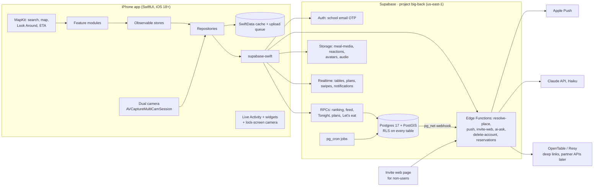

# BigBack: Technical Architecture

_Drafted 2026-10-15. Companion docs:_
- _[02-database-design.md](02-database-design.md)_
- _[../VISION.md](../VISION.md)_
- _[../design/01-core-experiences.md](../design/01-core-experiences.md)_
- _[../design/02-ai-features.md](../design/02-ai-features.md)_

Facts marked _(verify)_ come from third-party sources and should be confirmed before we depend on them.

---

## 1. Shape of the system



**Principles**
1. **The database is the backend.** Business rules live in Postgres: RLS for who sees what, and RPCs for multi-step writes like ranking, tagging, plans and swiping. Edge Functions only exist for things Postgres can't do (push, AI, web pages, external APIs). For a two-person team that means one place to reason about correctness, and no app server to run.
2. **Offline-first capture.** A meal and its photos must never be lost because of restaurant basement signal. The phone owns the truth until upload finishes.
3. **Licence-clean place data.** Apple and Google content stays on the device. Our database stores only their IDs plus open-licence data, admin data and user data (§5).
4. **Cheap by default.** MapKit is free. Supabase Pro is about $25/month. The only AI is a tiny Haiku-tier feature. No paid places API in v1.

---

## 2. iOS app

### 2.1 Platform

| | Choice | Why |
|---|---|---|
| Minimum iOS | **iOS 18.0** | `MKMapItem.Identifier` for stable Apple place IDs, the LockedCameraCapture extension, Control Center widgets, and the current SwiftData/Observation APIs. |
| Language | Swift 6 (strict concurrency) | Data-race safety for the camera, upload and realtime code. |
| UI | SwiftUI, with UIKit only where needed | `MKMapView` clustering, camera preview layer. |
| Backend SDK | `supabase-swift` (Auth, PostgREST, Storage, Realtime, Functions) | Official SDK, async/await. |
| Dependencies | Swift Package Manager only | supabase-swift, Nuke (image loading/caching), plus Sentry and PostHog (§9). |
| Devices | iPhone XS / A12 and newer for simultaneous dual camera | Older phones fall back to quick sequential back-then-front capture, like BeReal. |

### 2.2 Targets and modules

```
BigBack.xcodeproj
├─ BigBack (app)                    composition root, DI, deep links, push registration
├─ BigBackWidgets (extension)       Live Activity (meal in progress), home widget, Control Center button
├─ BigBackLockCamera (extension)    LockedCameraCapture: snap from lock screen → queued into the live meal
├─ BigBackNotificationService (ext) rich push (downloads the photo thumbnail into the notification)
└─ Packages/BigBackKit (local SPM package)
   ├─ Core            models (Codable mirrors of DB rows), IDs, errors, Date/Geo utils, ranking math (pure, unit-tested)
   ├─ DesignSystem    tokens (color/type/spacing/radius/motion), components, haptics: theme picked later
   ├─ Data            SupabaseClient wrapper, repositories, SwiftData cache, UploadQueue actor, Realtime hub
   ├─ Platform        Camera, Location, MapKit helpers, Notifications, LiveActivity, Reservations
   └─ Features
      ├─ Onboarding   email OTP, Starter Pack swipes, find friends
      ├─ Feed         full-screen following feed, post detail, reactions, comments
      ├─ Tonight      picks, craving chips, map, Ask BigBack bar, Let's eat
      ├─ Meal         live meal screen, camera, moments, dish chips, quick takes, What to order, tagging
      ├─ Rate         reaction → vibe → This-or-That → payoff; repeat-visit one-tap
      ├─ Plans        plan creation, RSVP, guest list, Let's eat swipe deck + match
      ├─ Place        place page: scores, map/Look Around, directions, reserve, dishes, meals
      ├─ Activity     notifications, invites, To-rate tray, challenges
      └─ Profile      you/others: ranked lists by vibe, Want to Try, map, stats, settings, privacy
```

Each feature module depends on `Core`, `DesignSystem` and repository **protocols** from `Data`, never on Supabase directly. The live repositories are injected at the app level; mocks are injected in previews and tests.

### 2.3 State, navigation, dependency injection
- **State:** one `@Observable` store per screen (`FeedStore`, `TonightStore`, `LiveMealStore`, `RateFlowStore`…), owned by the view with `@State`. The stores call repositories and expose plain values. No global mutable singletons except `AppSession` (auth state, current user, school).
- **DI:** a `Dependencies` struct of repository protocols, passed through `@Environment(\.deps)`. Live, preview and test variants exist.
- **Navigation:** a custom 5-tab bar (Feed · Tonight · ◉ Camera · Activity · You). Each tab is a `NavigationStack` driven by a typed `Route` enum. The camera, rate flow, Let's eat and plan creation are full-screen covers driven by an `AppRouter`.
- **Deep links:** universal links on `bigback.app`, all routed through `AppRouter` and the same routes:
  - `/p/{code}` plan
  - `/d/{code}` Let's eat
  - `/t/{code}` join a table
  - `/u/{handle}` profile
  - `/m/{id}` meal

### 2.4 Data layer
- **Reads:** PostgREST queries and RPCs. Feed and place lists use RPCs that return table rows with embedded joins, e.g. `rpc("get_feed").select("*, place:places(*), author:profiles(*), media:meal_media(*)")`. Pagination is keyset (`p_before = last posted_at`).
- **Cache:** SwiftData stores the last feed pages, my rankings, my saves, places I've touched and my drafts, so the app opens instantly and works offline for reading. The cache is invalidated by realtime events and pull-to-refresh.
- **Writes:**
  - Direct table writes where RLS allows them (meals, media rows, saves, reactions, comments, follows).
  - RPCs for multi-step logic (`submit_rating`, `tag_friends`, `create_plan`, `decide_vote`…).
- **Offline-first meals:**
  - The app generates UUIDs for meals and media, so retries are idempotent upserts.
  - The `UploadQueue` actor persists jobs in SwiftData, in order: create meal row → upload images → insert media rows → rating RPC.
  - Retries use exponential backoff and survive relaunch.
  - Uploads use a **background `URLSession`** against Storage signed upload URLs (`createSignedUploadURL`), so they finish even when the app is suspended.
- **Realtime hub:** one Realtime connection multiplexes:
  - `notifications` for me;
  - the active table (`party_members`, `meal_media`);
  - the active plan (`plan_guests`);
  - the active Let's eat session (`decide_votes`, plus Presence for "who's swiping" and Broadcast for the reveal animation).

### 2.5 Camera and capture pipeline
1. **Capture session.**
   - If `AVCaptureMultiCamSession.isMultiCamSupported`: two `AVCapturePhotoOutput`s (back wide + front), triggered together.
   - Otherwise a sequential fallback: back camera, then flip to front within about 300 ms.
   - No countdown timer (owner decision). Holding the shutter records a 3 s clip (back camera, H.264, 720p).
2. **Processing** (off the main thread):
   - HEIC → JPEG at 1600 px on the long edge, quality 0.8, plus a 400 px thumbnail.
   - **EXIF/GPS stripped**, because places are already known and raw coordinates would leak a home address on a home-cooked post.
3. **Moment + dish:** the chosen moment chip (walk-in / order / food / crew / damage report) and an optional dish chip are saved with the capture. Dish chips come from `dishes` for the place.
4. **Storage paths:** `meal-media/{uid}/{meal_id}/{media_id}_{back|front|thumb|clip}.{jpg|mp4}`. RLS on storage mirrors meal visibility (see the DB doc).
5. **Live badge:** `is_live = true` only when the shot was taken in-app during a live meal (not imported from the camera roll).
6. **Lock-screen capture:**
   - The LockedCameraCapture extension writes to an App Group container.
   - The main app moves those captures into the live meal on next launch or background refresh.

### 2.6 Maps and location ("where is it, how far is it")
- **Map UI:** SwiftUI `Map`, with `MKMapView` wrapped for clustering on the big map. Annotations are score badges coloured by tier; the user's location is shown with `UserAnnotation`.
- **Search:** `MKLocalSearchCompleter` + `MKLocalSearch`, restricted with `MKPointOfInterestFilter` (restaurant, cafe, bakery, brewery, winery, foodMarket, nightlife). Results merge with our own `search_places` RPC (places friends have ranked rank first).
- **Resolving a place:** when the user picks an Apple result that isn't in our DB yet, the app calls the `resolve-place` Edge Function with Apple's `MKMapItem.Identifier` and the on-device name and coordinate. The function:
  1. Matches an existing place by `apple_place_id`.
  2. Otherwise fuzzy-matches the open-data staging table (`place_import`) by name trigram within about 75 m.
  3. Otherwise creates a user-sourced place.

  Apple's name and coordinates are used only for this match, never stored (§5).
- **Distance and "how far":**
  - Lists show straight-line distance computed on device (instant) and an estimate of walking minutes.
  - The place page and the top 5 Tonight picks request a real ETA with `MKDirections.calculateETA` (walking / transit / driving, throttled and cached for 10 minutes).
- **Place page map:** a small `Map` header, `LookAroundPreview` when available, Apple's place card (`mapItemDetailSheet`, which shows Apple's own hours and photos without us storing them), and a **Directions** menu: Apple Maps, Google Maps (`comgooglemaps://`), Uber.
- **Permissions:**
  - **When-in-use** location is requested only when the user opens Tonight or starts a meal.
  - **Always** (needed for arrival nudges via `CLMonitor`) is a later opt-in, explained in context. It monitors at most 20 regions: upcoming plans plus the nearest Want-to-Try places.
  - **No location is ever sent to other users.** The server receives coordinates only as query parameters for nearby/Tonight; we don't store a location history.

### 2.7 Reservations (live reservations: what's actually possible)
Research (Oct 2026): **neither OpenTable nor Resy offers a self-serve public booking API.** Both are partner-gated: OpenTable through a partner/affiliate application and review, Resy through direct partnerships, with new partner APIs reported for 2026 _(verify)_. So it's done in phases:

| Phase | What the user sees | How |
|---|---|---|
| **v1 (launch)** | A **Reserve** button on place pages and plans that opens OpenTable or Resy (their app if installed, otherwise the web) for that restaurant, with party size, date and time pre-filled where the URL supports it. Places without a booking service show **Call** / **Walk-in**. | `places.reservation_provider` + `reservation_url`, curated for the Waterloo launch set and crowd-sourced via `place_edits` (reviewed before going live). After the tap, the plan's `reservation_status` becomes `link_opened`, then the host confirms with one tap. |
| **v1.x** | Real time slots shown inside BigBack ("7:00 · 7:30 · 8:15") with booking inside the app. | Apply to the **OpenTable Partner/Affiliate API** now, since approval takes weeks. A `reservations` Edge Function hides the provider behind one interface (`availability(place, party, date)`, `book(...)`). Resy is added when its partner API is reachable. |

The iOS side codes against a `ReservationProvider` protocol (`.deepLink`, `.phone`, `.walkIn`, later `.inApp`), so going from v1 to v1.x doesn't touch the UI.

### 2.8 Live Activity, widgets, notifications
- **Live Activity:**
  - Started on device when a meal begins, showing place, elapsed time, number of snaps, who's with you, and a Snap button (deep link to the camera).
  - For group meals, the `push` function updates it remotely through ActivityKit push tokens (`device_tokens.kind = 'live_activity'`) when someone joins or snaps.
  - It ends when the meal ends, or automatically after 3 hours (matching the cron job).
- **Widgets:** a home-screen "friends' latest bites" widget (fast-follow) and a Control Center button that opens the camera.
- **Push notifications:**
  - Rows are inserted into `notifications` by DB triggers. A `pg_net` webhook calls the `push` Edge Function, which sends via APNs (token auth, `.p8` stored in Edge Function secrets) and sets `pushed_at`.
  - Categories with actions: RSVP Going/Maybe from the lock screen; rate now.
  - Per-user preferences live in `profiles.notification_prefs`.
  - Quiet hours from 11 pm to 9 am are honoured, except for plan reminders.

### 2.9 Design system hooks (theme comes next)
- `DesignSystem` exposes **semantic tokens only**:
  - colours: `surface`, `ink`, `accent`, `tierLoved`…;
  - type ramp;
  - spacing scale;
  - radii;
  - **motion tokens**: spring presets for "snap", "reveal" and "slot-in", with durations.
- Every component reads tokens, so the theme the owner picks later is a one-file change, with dark mode and Dynamic Type supported from day one.
- Native-feel rules:
  - SF Symbols;
  - system materials for sheets;
  - `sensoryFeedback` haptics on swipe, snap and rank;
  - `matchedGeometryEffect` for the This-or-That → payoff transition;
  - respect Reduce Motion.

### 2.10 Testing
- **Swift Testing** for `Core`: ranking math (binary insertion within a vibe, band scores, tie handling), distance/ETA formatting, model decoding.
- **Store tests** with mock repositories.
- **UI tests** for the 4 critical flows: onboarding, live meal → rate → post, Let's eat, plan RSVP.
- **Database tests:** `supabase/tests/smoke_test.sql` runs every RLS rule and RPC under real user identities (rolled back), in CI and after every migration.

---

## 3. Backend (Supabase)

### 3.1 Postgres
- **Schema:** 41 tables, RLS on all of them. See [02-database-design.md](02-database-design.md).
- **Extensions:** PostGIS (`geography(Point)` + GiST), pg_trgm (fuzzy search), citext (handles), unaccent, pg_net (webhooks), pg_cron.
- **Where writes go:**
  - **Direct, under RLS:** simple user-owned rows.
  - **RPCs** (`SECURITY DEFINER`, `search_path` pinned): anything that touches other users' rows or keeps invariants, such as ranking positions, party membership, swipe matching and plan invites.
- **System-owned columns** (a meal's tier/score/posted_at, a profile's school) are protected by BEFORE UPDATE guard triggers. Column REVOKEs don't work because of table-level grants.

### 3.2 Auth
- **Email OTP** (6-digit code, no password) restricted to live school domains by the **before-user-created** hook `public.hook_before_user_created`.
  - Launch domain: `uwaterloo.ca`. Other domains go to a waitlist screen.
  - A profile is created by the `on_auth_user_created` trigger, which derives the handle and assigns the school from the email domain.
- **Later:**
  - Sign in with Apple, linked to the verified school email.
  - Alumni and co-op students keep access after graduating because accounts aren't re-verified.
- **Sessions:** Keychain storage via supabase-swift, refresh-token rotation on.

### 3.3 Storage
| Bucket | Public | Who can read | Who can write |
|---|---|---|---|
| `meal-media` | no | Anyone who can see the meal (same rule as the meal row) | Owner, into `{uid}/{own meal}/` only |
| `reactions` | no | Anyone who can see the meal | Anyone who can see the meal (own folder) |
| `avatars` | yes (CDN) | Everyone | Owner folder |
| `audio` | no | Owner only | Owner |

- Clients fetch signed URLs (1-hour expiry) in batches, and Nuke caches the images.
- Supabase Image Transformations (Pro) can later replace client-made thumbnails if needed.

### 3.4 Realtime
- Postgres Changes, which respect RLS, on:
  - `notifications`
  - `party_members`
  - `meal_media`
  - `plan_guests`
  - `decide_sessions`
  - `decide_participants`
  - `decide_votes`
- Broadcast + Presence channels for Let's eat (who's swiping, match reveal) and for a table (who's here).

### 3.5 Edge Functions (Deno/TypeScript)
| Function | Trigger | Does |
|---|---|---|
| `resolve-place` | App, when picking a MapKit result | Apple ID → our place (match by ID, then open-data fuzzy match, then create) |
| `push` | `pg_net` webhook on `notifications` insert, plus a cron sweep for retries | APNs alerts + Live Activity updates; quiet hours; sets `pushed_at` |
| `invite-web` | Public HTTPS (`bigback.app/p/…`, `/d/…`) | Server-rendered RSVP and swipe pages for people without the app; writes guest RSVPs and votes with the service role, keyed by an unguessable code + guest token; Open-in-app banner |
| `ai-ask` | App (Ask BigBack) | Haiku-tier Claude with read-only tools that call our RPCs as the user; returns place cards; rate-limited via `ai_requests` (§6) |
| `delete-account` | App | Deletes the user's Storage objects, then calls `delete_my_account()` (App Store 5.1.1(v)) |
| `reservations` | App (v1.x) | Provider-agnostic availability and booking (OpenTable partner API) |
| `place-external` | App (optional, §5.3) | Live external rating for the place page; never stored |

Secrets (`APNS_KEY_P8`, `APNS_KEY_ID`, `APNS_TEAM_ID`, `ANTHROPIC_API_KEY`, `OPENTABLE_*`) live only in Edge Function secrets.

### 3.6 Scheduled jobs (pg_cron, UTC)
| Job | Schedule | Does |
|---|---|---|
| `close-stale-meals` | every 10 min | Live meals older than 3 h → `unrated` (To-rate tray) |
| `refresh-place-stats` | every 15 min | Campus Bayesian score, loved count, saves, 7-day activity, trending |
| `refresh-user-similarity` | daily 08:15 UTC (04:15 Waterloo) | Pearson taste match for pairs with 5+ shared places |
| `expire-decide-sessions` | every 15 min | Close Let's eat sessions past `expires_at` |
| `mark-plans-done` | hourly | Plans 6 h past their start time → `done` |
| _later_ | weekly (Sun 18:00 local) | Sunday Bites digest notifications; settle-it card generation |

---

## 4. The ranking engine (where the product's credibility comes from)

Full rules: [design/01-core-experiences.md §C](../design/01-core-experiences.md). Implementation:
1. The client fetches the user's list for the chosen **reaction tier**: `rankings` for `(user, tier)` ordered by `position`.
2. **Binary insertion against same-vibe places only**, capped at 3 This-or-That comparisons, runs on the device. This is pure Swift in `Core` and unit-tested. Each card shows the user's own photo from that visit.
3. The client calls `submit_rating(meal, tier, vibe, position, settled, comparisons[])`. In one transaction, the server:
   - shifts positions;
   - recomputes the tier's scores with `tier_score()`;
   - records the comparisons;
   - posts the meal;
   - returns the score and the vibe rank for the payoff screen.
4. **Scores stay inside fixed bands:** loved 8.0–10, good 6.0–7.9, mid 4.0–5.9, nah 0–3.9. Drift is bounded, and 8+ always means "loved".
5. **Repeat visits** call `rerate_visit(meal, better|same|worse)`. **Drag-to-reorder** calls `move_ranking`. **Settle it / Defend your #1** calls `record_comparison`.
6. **Aggregates:**
   - campus `bayes_score` (C = 5);
   - `predicted_score` (similarity-weighted, shrunk toward the campus score);
   - Taste Match % (Pearson r, needs 5+ shared places).

---

## 5. Restaurant data, maps, reservations and outside reviews

The owner asked which open sources, maps and services we can use for real restaurants and reviews (Google, OpenTable, Resy, Yelp…), and whether to mix outside reviews with BigBack's own. Each source, with what we're allowed to do:

### 5.1 Sources

| Source | What we get | What we may store | Cost | Use in BigBack |
|---|---|---|---|---|
| **Apple MapKit** (on device) | Search, map tiles, POI categories, place card (with Apple's hours/photos), Look Around, ETAs | **Only the Place ID** (Apple explicitly allows persisting it). Not names, coordinates or hours: licence §2.2/§2.5 forbid storing them in our DB, and Apple data must be shown with an Apple map | Free | Primary search and map on iOS |
| **Foursquare OS Places** (Apache 2.0) | 100M+ POIs: name, address, coordinates, category, phone, website | Everything (with attribution) | Free | Canonical place records for the launch region (via `place_import`) |
| **Overture Maps places** (CDLA-Permissive / Apache) | Similar POIs with confidence scores | Everything (with attribution) | Free | Backup / cross-check source |
| **OpenStreetMap** (ODbL) | Good student-area coverage and **opening hours** | Yes, but share-alike applies to a derived database, so keep it in its own table (`place_hours` with `source='osm'`) and publish it under ODbL if required _(lawyer check)_ | Free | Opening hours for "open now" |
| **Google Places API (New)** | Ratings, review snippets, photos, hours | **Only `place_id`** (lat/lng ≤ 30 days). Content can't be stored or shown alongside a non-Google (Apple) map; requires Google attribution | Ratings are an Enterprise-tier field: about $20/1k calls after 1k free per month _(verify current SKUs)_ | Optional, see 5.3 |
| **Yelp Fusion / Places API** | Rating, review count, up to 3 review excerpts | Limited caching; attribution required _(verify current terms)_ | Paid plans only since 2024 (about $229/month reported) _(verify)_ | Optional, see 5.3 |
| **OpenTable** | Booking deep links; partner API for slots/booking | Restaurant IDs | Partner approval | Reserve button (v1) → in-app slots (v1.x) |
| **Resy** | Deep links / widget; partner API (2026) _(verify)_ | Venue slugs | Partnership | Reserve button |

**Getting data in:** Foursquare and Overture can't be downloaded from this build environment (its network policy blocks those hosts). The import will run from your machine, or from an Edge Function that streams the launch-region slice (Waterloo Region bounding box, Dining & Drinking categories) into `place_import`. Places are then promoted to `places` when someone ranks one, plus an admin-curated "Waterloo Starter Pack" of about 150 spots with hours and reservation links.

### 5.2 Should outside reviews be mixed with BigBack's? **Recommendation: no, keep them separate.**
- BigBack's value is **honest, comparable rankings from people you know**. Averaging in Google's 4.3★ (stranger star inflation, a different scale, possibly years old) would weaken exactly what makes our numbers trustworthy, and licensing forbids blending Google data anyway.
- The place page leads with **BigBack scores**: You · People you follow · UW campus · Predicted for you, plus friends' posts and photos.
- Outside opinions appear as a **clearly labelled, secondary "Around the web" row**:
  - **v1 (free, zero licence risk):** buttons, not numbers: _Reviews on Google Maps_ · _Yelp_ · _Menu_ · _Reserve_. These are deep links (`comgooglemaps://?q=…&query_place_id=…`, `yelp://biz/…`).
  - **Optional later:** a live "Google 4.4 · 1.2k reviews" chip fetched on demand by `place-external`, shown only on a map-less sheet with Google attribution, never stored. It mainly helps **cold-start places** with fewer than 5 BigBack ratings. It costs money per view, so it should be gated behind a tap. Yelp is the alternative if its terms allow display next to our UI.
- **Cold start, the real reason you'd want outside reviews:** we solve it on our side instead:
  - the Starter Pack onboarding swipe gives every new user 10–25 ranked places in the first minute;
  - campus scores fill in quickly at one school;
  - "Around the web" links cover the gap meanwhile.

### 5.3 Data model hooks (already in the schema)
- `places.apple_place_id`, `google_place_id`, `fsq_place_id`, `overture_id`, `osm_id`, `yelp_business_id`, `reservation_provider`, `reservation_url`, `menu_url`
- `place_hours (source)`, `place_import` (staging), `place_edits` (crowd corrections, moderated)

---

## 6. AI (small and cheap, by owner decision)
- **Scope v1:** only the **Ask BigBack** bar on Tonight. Everything else from the AI doc is parked.
- **Flow:**
  1. The app calls the `ai-ask` Edge Function, which runs the Anthropic TypeScript SDK with **read-only tools** (`tonight_picks`, `search_places`, `get_place_scores`, follows' recent activity).
  2. The tools execute **as the user** (their JWT is forwarded, so RLS applies).
  3. Structured output returns `[{place_id, reason}]`, and the app renders only place IDs that came back from the tools, so the model can't invent restaurants.
- **Model:** the owner asked for `claude-haiku-4-5` ($1 / $5 per MTok). `claude-haiku-5-5` is newer and about 10× cheaper ($0.10 / $0.50) and is recommended. The model ID lives in `app_config.ai.model`, so switching needs no app release.
- **Limits:** 10 asks per user per day (`app_config.ai.daily_limit`), logged in `ai_requests`.
- **Cost:** at 10k MAU × 10 asks/month, roughly $100/month on Haiku 4.5, or about $10 on Haiku 5.5 _(estimate)_.

---

## 7. Web surface (growth loop)
- **Domain:** `bigback.app` (placeholder): a tiny site, either static on Cloudflare Pages or served by the `invite-web` function. Pages:
  - `/p/{code}`: plan card (place, time, who's going), RSVP with name only, "Get the app".
  - `/d/{code}`: Let's eat swipe deck for non-users; their votes count.
  - `apple-app-site-association` for universal links, plus an App Clip later.
- **Privacy:** invite pages show only first names and avatars of people going, and only to people holding the unguessable code.

---

## 8. Security, privacy, compliance
- **RLS everywhere.** Test it with the smoke test, under user identities, in CI.
- **No secrets in the app** except the publishable key, which is designed to be public. **Secret keys never leave Supabase.**
- **App Store:**
  - 1.2 (user-generated content): report, block, a content filter on comments, and a moderation queue (`reports`).
  - 5.1.1(v): in-app account deletion.
  - Location purpose strings; Sign in with Apple when we add third-party logins.
  - Age rating 17+ is likely, given UGC; confirm with App Store Connect.
- **Canada (PIPEDA) + Ontario students:**
  - A privacy policy that names the data we keep: email, photos, rankings, approximate place visits.
  - Consent for contacts upload (optional).
  - Data is stored in the US (us-east-1), and the policy must say so. Moving to `ca-central-1` would mean a new project before launch; that decision belongs to the owner.
- **Photos:** EXIF/GPS stripped on device; selfies visible only per meal visibility; no face recognition.
- **Abuse:**
  - Rate limits on RPCs that fan out (tags ≤ 20, Let's eat ≤ 12 people, comparisons ≤ 10 per rating).
  - Invite codes are random 10-hex strings, and join codes expire after 12 hours.
- **Repo:** currently **public**. It holds no secrets, but it does contain product strategy. Recommendation: make it private.

---

## 9. Observability and analytics
- **Crashes:** Sentry (iOS + Edge Functions), free tier.
- **Product analytics:** PostHog (free tier). Key events:
  - `meal_started`, `snap_taken`, `rating_completed` (with comparison count and time to rate);
  - `post_viewed`, `saved`, `plan_created`, `rsvp`, `decide_match`, `ask_bigback`.
- **North-star metrics:**
  - weekly meals rated per active user;
  - % of meals with a live snap;
  - plans → meals conversion.
- **Database:** Supabase advisors (security + performance) in CI after each migration; `pg_stat_statements` reviewed weekly.

## 10. Environments, CI/CD, releases
| Env | What | How |
|---|---|---|
| Local | Supabase CLI + Docker | `supabase start`; the same migrations from `supabase/migrations` |
| Staging | Second Supabase project (free tier) or a Supabase branch | Migrations applied by a GitHub Action on merge to `main` |
| Prod | `big-back` | Migrations applied by an Action on a release tag. _(Tonight's migrations were applied directly because the project is pre-launch.)_ |

- **CI (GitHub Actions):**
  - iOS build + tests on a macOS runner;
  - SwiftLint;
  - `supabase db lint` + smoke test against local Supabase.
- **TestFlight via Xcode Cloud:** 25 free hours/month with the developer program.
- **Branching:** `main` is protected; feature branches go through PRs.

## 11. Cost (monthly, rough)
| Item | 10k MAU | 100k MAU |
|---|---|---|
| Supabase (Pro + compute + storage/egress for photos) | $25–60 | $150–400 _(verify with photo volume)_ |
| MapKit | $0 | $0 |
| AI (Haiku tier, 10 asks/user/month) | $10–100 | $100–1,000 |
| APNs | $0 | $0 |
| Sentry / PostHog | $0 (free tiers) | ~$50–100 |
| Apple Developer | $99/yr | $99/yr |

## 12. Build order (milestones)
1. **M0 · Foundations:**
   - Xcode project + modules; design tokens (once the theme is picked);
   - Supabase client; auth (OTP + school gate); profile; CI.
2. **M1 · Core loop:**
   - live meal + dual camera + upload queue;
   - rate flow (ranking engine);
   - feed; place page; Want to Try.
3. **M2 · Decide:**
   - Tonight (picks, map, craving chips, Ask BigBack);
   - plans + RSVP + invite web page;
   - Reserve deep links.
4. **M3 · Together:**
   - tagging/tables + Table Verdict;
   - Let's eat;
   - Live Activity; push.
5. **M4 · Launch polish:**
   - Starter Pack onboarding; streaks; campus leaderboard;
   - moderation tools; App Store review.
   - Launch at UW at the start of the Winter 2027 term (January).
6. **Fast follow:** Food Fights, Sunday Bites, Term Wrapped, widgets, OpenTable in-app slots.

## 13. Decisions waiting on the owner
1. **Visual theme:** colours, fonts and motion personality. This is the next step.
2. **AI model:** Haiku 4.5 (as requested) vs Haiku 5.5 (newer and about 10× cheaper).
3. **Outside reviews:** v1 deep links only (recommended), or pay for a live Google/Yelp rating chip.
4. **Data region:** keep `us-east-1`, or recreate in `ca-central-1` before launch.
5. **OSM hours:** accept ODbL share-alike on the hours table (recommended), or curate hours by hand.
6. **Repo visibility:** make the repo private.
7. **Domain** for invite links (e.g. `bigback.app`), and the Apple Developer account, so APNs keys can be created.
