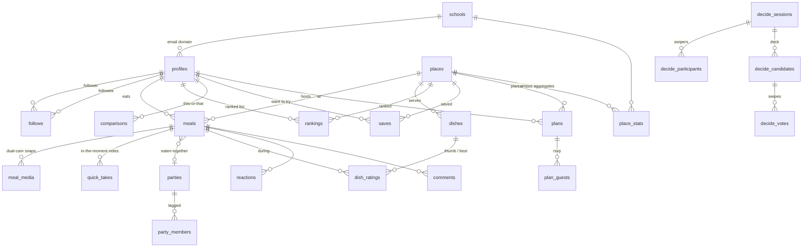

# BigBack: Database Design

_Supabase project `big-back` (`iefchnylrxolydtulmgt`), Postgres 17, region us-east-1, serving Canadian and US users (see the architecture doc §8 for data residency). Source of truth: `supabase/migrations/`.
Drafted 2026-10-15. Any deviations made while applying the migrations are logged in `docs/handoff/db-status.md`._

## 1. Overview

- **41 tables in `public`, RLS on every one.**
- Writes that need invariants go through `SECURITY DEFINER` RPCs with `search_path` pinned.
- A smoke test (`supabase/tests/smoke_test.sql`) exercises the rules as real users inside a rolled-back transaction.

| Domain | Tables |
|---|---|
| Identity & social | `schools`, `profiles`, `follows`, `blocks`, `crews`, `crew_members` |
| Places | `places`, `place_hours`, `place_import`, `place_edits`, `place_stats`, `saves` |
| Meals & capture | `parties`, `party_members`, `meals`, `meal_media`, `quick_takes`, `dishes`, `dish_ratings` |
| Rankings | `rankings`, `comparisons`, `user_similarity` |
| Interactions & safety | `reactions`, `comments`, `reports` |
| Plans & Let's eat | `plans`, `plan_guests`, `decide_sessions`, `decide_participants`, `decide_candidates`, `decide_votes` |
| Ops | `notifications`, `device_tokens`, `ai_requests`, `app_config` |
| Gamification | `seasons`, `badges`, `user_badges`, `food_fights`, `fight_matchups`, `fight_votes` |

## 2. Entity relationships (core)



## 3. Key tables

### profiles
- **App Review / demo accounts:** `is_demo` (set from `signup_allowlist`, not changeable by clients). Demo accounts are excluded from campus stats and leaderboards. `signup_allowlist` lets specific non-school emails (the App Review account) sign up.
- **Purpose:** 1:1 with `auth.users`, created by the `on_auth_user_created` trigger.
  - The handle comes from the email local part, de-duplicated.
  - `school_id` comes from the email domain.
- **Key columns:** `handle citext unique` (3–24 characters `[A-Za-z0-9_.]`), `display_name`, `avatar_path`, `bio`, `is_private`, `notification_prefs jsonb`, `onboarded_at`.
- **Guard:** clients can't change `school_id` or `created_at`.

### follows
- **Columns:** `(follower_id, followee_id)` PK, `status accepted|requested`, `accepted_at`.
- **Behaviour:** a trigger forces `requested` when the followee is private and `accepted` otherwise. Only the followee can accept. A block deletes follows both ways.

### places
- **Purpose:** our canonical record.
- **Key columns:**
  - `location geography(Point,4326)` (GiST index)
  - `name_key` (generated, unaccented lower-case, trigram index)
  - `primary_category`, `cuisines[]`, `tags[]` (GIN)
  - `price_level 1–4`
  - `reservation_provider`, `reservation_url`, `menu_url`
- **External IDs** (`apple_place_id`, `google_place_id`, `fsq_place_id`, `overture_id`, `osm_id`, `yelp_business_id`): unique, IDs only, no copied provider content.
- **Related tables:**
  - `place_hours` (dow/opens/closes; an overnight slot has `closes <= opens`)
  - `place_import` (open-data staging, service-role only)
  - `place_edits` (crowd corrections, moderated)
  - `place_stats` (per school: `n_ratings`, `n_loved`, `mean_score`, `bayes_score`, `n_saves`, `n_meals_7d`, `trending_score`)

### meals: the central object
- **Lifecycle:**

  ```
  live ──(end / 3h cron)──▶ unrated ──submit_rating / rerate_visit──▶ posted ──▶ archived
  ```
- **Columns:**
  - `id` is client-generated, which makes offline upserts idempotent.
  - `user_id`, `place_id`, `party_id`, `plan_id`, `visibility followers|only_me`
  - `started_at` / `ended_at` / `posted_at`
  - `tier`, `vibe`, `score_at_post`, `visit_delta` (repeat visits)
  - `note`, `price_per_person`, `currency`, `cover_media_id`
- **Constraints:**
  - `posted ⇒ tier, vibe, posted_at not null`.
  - At most **one live meal per user** (partial unique index).
- **Guard trigger:**
  - Clients can't set `tier`/`score_at_post`/`posted_at`/`visit_delta` or flip to `posted`. Only the RPCs can.
  - A posted meal can't go back to live or unrated, or change place.

### meal_media
- **Purpose:** a BeReal-style capture.
- **Columns:**
  - `kind dual|single|clip`
  - `back_path`, `front_path`, `thumb_path`, `video_path` (Storage paths)
  - `moment walk_in|order|food|crew|damage_report|other`
  - `dish_id`, `caption`, `is_live`, `taken_at`, `sort_order`
- **Shared album:** all `meal_media` of meals sharing a `party_id`.

### parties / party_members
- **Purpose:** "eating together".
- **How it's created:**
  - `tag_friends()` creates the party and pending invites.
  - `respond_party_invite(accept)` creates the invitee's own meal (live, or unrated if they already have a live one).
  - `join_party(code)` handles QR joins (the code is valid for 12 hours).
- **Table Verdict:** sent when every meal in the party is posted.

### rankings: the ranked lists
- **Columns:** `(user_id, place_id)` PK, `tier`, `vibe`, `position` (0-based within `(user, tier)`), `score`, `settled`, `visits`, `last_meal_id`.
- **Constraint:** `unique (user_id, tier, position)`, **deferrable**, so positions can shift inside one statement.
- **Write path:** RPCs only.
  - `submit_rating(meal, tier, vibe, position, settled, comparisons[])`
  - `rerate_visit(meal, better|same|worse)`
  - `move_ranking(place, tier, position, vibe?)`
  - `record_comparison(winner, loser, settle|defend, tie)`
- **Score:** `tier_score(tier, pos, n) = round(high − (high − low) · (pos + 0.5)/n, 1)`, with bands loved 8.0–10.0, good 6.0–7.9, mid 4.0–5.9, nah 0.0–3.9.

  | n places in tier | #1 score (loved) | last (loved) |
  |---|---|---|
  | 1 | 9.0 | 9.0 |
  | 2 | 9.5 | 8.5 |
  | 10 | 9.9 | 8.1 |
- `comparisons` keeps every This-or-That (source `rate|settle|defend|fight|reorder`), for future ranking models and Food Fight results.
- `user_similarity` (nightly, upsert-only): Pearson r over shared places, kept only when `n_shared ≥ 5`.

### plans / plan_guests
- **Plans:**
  - Start time and a random `invite_code` (10 hex) for links.
  - `reservation_status none|link_opened|confirmed|cancelled`, `reservation_ref`.
  - `status planned|cancelled|done` (cron marks plans done 6 hours after start).
- **Guests:** app users (`user_id`) or web guests (`guest_token`, `guest_name`). RSVP values: `invited|going|maybe|cant`.

### decide_* ("Let's eat")
- `create_decide_session(members[], lat, lng, crew?, constraints, size)` builds a deck of 3–15 candidates:
  - **Group score:** average of each member's `predicted_score`.
  - **Least misery:** a place is excluded if any member's prediction is below 5.0 or any member ranked it `nah`.
  - **Boost:** +0.4 per member who saved the place.
  - **Constraints:** radius, `max_price`, craving, open at the planned time.
- `decide_vote(session, place, liked)`: a unanimous like matches immediately.
- `decide_finalize` (host): most likes wins, ties go to the higher group score.
- Web guests vote through the `invite-web` Edge Function (service role).

### notifications
- **Columns:** `kind`, `actor_id`, `meal_id`, `plan_id`, `place_id`, `payload`, `read_at`, `pushed_at`.
- **Written by triggers:**

  | kind | When |
  |---|---|
  | `follow` / `follow_request` / `follow_accepted` | Follow events |
  | `reaction` / `comment` / `comment_reply` | Interactions on your meal |
  | `meal_tag` | Someone tagged you at their table |
  | `plan_invite` / `plan_rsvp` | Plan invites and RSVPs |
  | `friend_went` | Someone you follow posted a place on your Want-to-Try |
  | `table_verdict` | Everyone in your party has rated |
  | `decide_match` | Your Let's eat session matched |

- **Rules:** never notify yourself or across a block. Pushed by the `push` Edge Function.

## 4. Visibility model (RLS)

| Data | Who can read |
|---|---|
| Profile basics | Any signed-in user, unless blocked either way |
| Posted meals, media, dish ratings, rankings, saves, badges | Author; if author is **public**, any signed-in user; if **private**, accepted followers only; never across a block |
| `only_me` meals | Author (+ their party) |
| Live / unrated meals and their media | Author + accepted party members (shared album) |
| Quick takes, comparisons, notifications, device tokens, own reports, own place edits | Owner only |
| Plans + guest lists | Host, guests, crew members |
| Let's eat sessions, candidates, votes | Host + participants |
| Places, hours, stats, dishes, seasons, badges, fights, app config | Everyone signed in (app config & schools also anon) |
| `place_import`, `ai_requests` | Service role only |

**Helpers** (all `SECURITY DEFINER`, used inside policies so RLS doesn't recurse):
- `can_view_user_content(author)`
- `can_view_meal(meal)`
- `is_party_member(party, user)`
- `is_crew_member(crew, user)`
- `can_view_plan(plan)`
- `is_decide_participant(session, user)`
- `is_blocked_between(a, b)`
- `is_following(a, b)`

**Guard triggers** stop clients from changing system-owned columns:
- profile school;
- meal rating fields and posting;
- parent IDs on media, guests, members, reactions, comments, dish ratings, saves.

## 5. RPC catalogue (client-callable, signed-in only)

| RPC | Returns | Use |
|---|---|---|
| `get_feed(before, limit)` | `setof meals` | Following feed (+ own), keyset by `posted_at`; embed place/author/media via PostgREST |
| `get_place_meals(place, before, limit)` | `setof meals` | Place page posts, follows first |
| `get_place_scores(place)` | row | You / following avg + count / campus Bayesian + count / predicted / saved / friends saved / open now |
| `tonight_picks(lat, lng, craving, vibe, max_price, radius_m, novelty, limit)` | rows | Ranked picks with reason fields (top friend + score, loved count, saved, open now, walk minutes) |
| `search_places(q, lat, lng, limit)` | rows | Trigram search, distance-aware |
| `nearby_places(lat, lng, radius_m, limit)` | rows | Map viewport |
| `resolve_place(apple_id, name, lat, lng, category, address)` | uuid | MapKit result → our place (Apple ID → nearby similar name → open-data promote → new user place, max 30 per day) |
| `predicted_score(place, user)` | numeric | Similarity-weighted, shrunk to the campus score (k = 2) |
| `submit_rating(...)`, `rerate_visit(...)`, `move_ranking(...)`, `record_comparison(...)` | | Ranking engine |
| `tag_friends(meal, users[])`, `respond_party_invite(party, accept)`, `join_party(code)` | | Eating together |
| `create_plan(place, starts_at, invitees[], crew, note, decide_session)`, `rsvp(plan, rsvp)`, `plan_by_code(code)` | | Plans |
| `create_decide_session(...)`, `decide_vote(...)`, `decide_finalize(session)` | | Let's eat |
| `fight_vote(matchup, winner)` | | Food Fights (only if you've eaten at both) |
| `user_streak(user)`, `leaderboard(season, limit)`, `taste_match(other)` | | Gamification |
| _(account deletion)_ | | Not an RPC: the `delete-account` Edge Function deletes Storage files, then calls `auth.admin.deleteUser` (cascades to every owned row) |

## 6. Storage layout
```
meal-media/{user_id}/{meal_id}/{media_id}_{back|front|thumb|clip}.{jpg|mp4}   private, read = can_view_meal
reactions/{user_id}/{meal_id}/{kind}.jpg                                      private, read = can_view_meal
avatars/{user_id}/{file}.jpg                                                  public
audio/{user_id}/{meal_id}/{quick_take_id}.m4a                                 private, owner only
```

## 7. Jobs, realtime, seed
- **Cron:** close stale meals (10 min), refresh place stats (15 min), user similarity (daily), expire Let's eat sessions (15 min), mark plans done (hourly).
- **Realtime publication:** `notifications`, `party_members`, `meal_media`, `plan_guests`, `decide_sessions`, `decide_participants`, `decide_votes`.
- **Seed:**
  - the University of Waterloo school (`uwaterloo.ca`, live);
  - the Fall 2026, Winter 2027 and Spring 2027 seasons;
  - 9 badges;
  - `app_config` (AI model + daily limit, ranking limits, meal auto-close, min app version).

## 8. Indexing notes
- Feed: `meals (user_id, posted_at desc) where status='posted'`, plus a `follows` PK lookup.
- Place pages: `meals (place_id, posted_at desc) where status='posted'`, `rankings (place_id)`.
- Geo: GiST on `places.location`, `place_import.location`.
- Search: trigram GIN on `places.name_key`, `dishes.name_key`, `profiles.handle/display_name`.
- Partial indexes for live meals, open reports, upcoming plans, unpushed notifications.

## 9. Scale notes
At one campus (tens of thousands of users), every query here is index-backed. Three things to watch as we grow:
- **`_refresh_user_similarity`** is O(pairs per place). Past roughly 50k active rankers, move it to incremental updates or matrix factorisation.
- **`predicted_score`** is computed on the fly. Once Tonight's latency exceeds about 150 ms, materialise per-user predictions for nearby places.
- **Feed** is fan-out-on-read, which is fine up to roughly 1k follows per user. Beyond that, add a `feed_items` fan-out-on-write table.

## 10. Not in the schema yet (intentionally)
- DMs / group chat. Plans have a guest list; chat lives in iMessage via the share link for now.
- Restaurant-side accounts, promotions, student deals (monetisation, later).
- Stored copies of external reviews (licence-forbidden, see the architecture doc §5).
